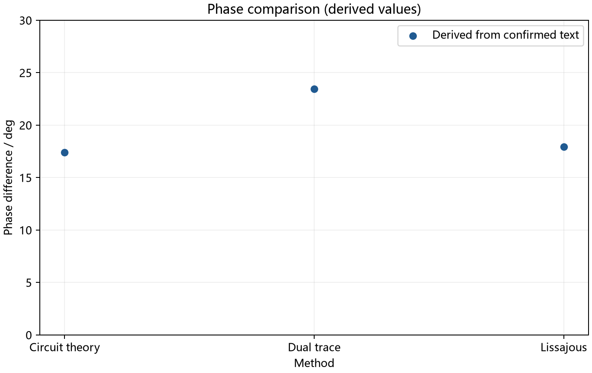

# 数字示波器及其应用Ⅱ：课后报告示例

正文外说明：采用[已确认的文字数据](data.md)，未重新核验原截图与电路图。数值计算由Python复算；独立的实验原理部分按默认规则省略。下图是计算结果比较，不是重建的示波器波形。缺失的FFT和教材思考题保留待补。

---

## 一、实验目的

1. 观察RC电路放电过程，测量时间常数并估算电容。
2. 比较电路参数计算、双踪显示法和李萨如图形法得到的相位差。
3. 通过FFT观察不同信号的频谱组成。

## 二、实验仪器与实验方法

使用数字示波器、电阻、电容及连接导线。RC放电部分电阻为20 kΩ，电容标称值为47 μF；移相部分电阻为10 kΩ，电容为0.1 μF。具体型号与电路连接待课程原图核对。

RC部分测量电压从初始值降至约初始值的36.8%所需时间。移相部分通过双踪模式测量时间差和周期，通过XY模式记录椭圆全宽与截距宽度，计算相位差大小。FFT部分的具体操作与结果记录待补。

## 三、实验内容及数据处理

### 1. RC时间常数与电容

已确认$E=8.90\,\mathrm V$、$U=3.30\,\mathrm V$、原始光标差$\Delta t=-760.0\,\mathrm{ms}$。由于光标顺序反向，计算经过时间取其大小。$U/E\approx0.3708$，接近$e^{-1}\approx0.3679$，按阈值法近似得到

$$\tau\approx|\Delta t|=760.0\,\mathrm{ms}=0.760\,\mathrm s.$$

$$C\approx\frac{\tau}{R}=\frac{0.760\,\mathrm s}{20\times10^3\,\Omega}=38.0\,\mu\mathrm F.$$

与47 μF标称值的相对偏差为

$$D_C=\frac{|38.0-47|}{47}\times100\%\approx19.1\%.$$

上述结果依赖阈值近似；未把标称值当作电容真值，也未将偏差解释为测量不确定度。

### 2. 相位差大小

采用历史文字记录中的电路关系，$f=49.8533\,\mathrm{Hz}$、$R=10\,\mathrm{k}\Omega$、$C=0.1\,\mu\mathrm F$：

$$\varphi_0=\arctan(2\pi fRC)=\arctan(2\pi\times49.8533\times10^4\times10^{-7})\approx17.39^\circ.$$

双踪法原始时间差为−1.30 ms；用户确认39.90 ms跨越两个周期，因此

$$T=\frac{39.90}{2}\,\mathrm{ms}=19.95\,\mathrm{ms},\qquad |\varphi_1|=\frac{1.30}{19.95}\times360^\circ\approx23.46^\circ.$$

李萨如图形中，A与B都取相应的全宽，已确认$A=19.50\,\mathrm V$、$B=6.00\,\mathrm V$。在该记录采用的锐角分支下，

$$|\varphi_2|=\arcsin\frac BA=\arcsin\frac{6.00}{19.50}\approx17.92^\circ.$$

| 方法 | 相位差大小 | 与理论值的相对差异 |
|---|---:|---:|
| 电路参数计算 | 17.39° | — |
| 双踪显示法 | 23.46° | 34.9% |
| 李萨如图形法 | 17.92° | 3.03% |

相对差异由未舍入的中间结果计算：$D_i=|\varphi_i-\varphi_0|/\varphi_0\times100\%$。表中的角度保留到0.01°用于比较，不代表仪器具有该测量精度。已有资料不足以判定相位超前或滞后。

手绘说明：这是一幅方法比较图，不进行拟合。横轴为三个方法，等间隔列出电路参数计算、双踪法、李萨如法；纵轴为相位差大小，单位为度，可取0～30°、每大格5°。按表格标三个点，写清方法名称，不将分类点连成代表频率响应的曲线。原始示波器波形缺少逐点数据，不能据此重画。

### 3. FFT观察（待补）

当前没有FFT截图或峰值记录，不能报告实测频率与谐波幅值。理想50%占空比的对称方波含基频及奇次谐波，理想正弦波只有单一频率分量，这是理论预期，不能代替实际频谱观察。

### 4. 不确定度说明

目前没有重复测量记录与仪器精度依据，不进行数值不确定度估计或误差传递；补充这些资料后再按课程要求评估。本次只计算结果与标称值或理论值的差异。

## 四、小结（结论、误差分析及建议等）

### 1. 实验结论

本实验通过数字示波器研究RC放电与交流信号相位差。电容电压由8.90伏下降至3.30伏，对应时间间隔为0.760秒；按阈值法近似得到时间常数，并算得电容约38.0微法，与47微法标称值的相对偏差约为19.1%。移相部分的理论相位差约为17.39度，双踪法和李萨如法分别得到23.46度与17.92度。本组记录中，李萨如法结果与理论值更接近，但这一比较不能证明该方法在所有条件下都更准确。FFT资料尚缺，暂不能给出实际频谱结论。

### 2. 误差分析

RC测量采用的终点电压只是接近初始电压的百分之三十六点八，阈值近似会影响时间常数；元件实际值与标称值的差异也可能影响比较。光标定位及电路非理想特性是需要进一步检查的因素。双踪法测量的时间差较小，相同的定位偏差可能带来较大的相对影响；跨越两个周期的读数若按单周期处理，还会直接改变结果。李萨如法需要正确辨认截距和全宽。由于原图未复核，不能断言波形失真或椭圆边缘模糊确实发生，也无法据现有记录确定各误差来源的大小。光标差的负号在本记录中表示选取方向，而相位的超前或滞后需结合通道和电路定义判断，两者不能混用。还应将标称值比较与测量不确定度区分，避免把相对偏差直接当成精度指标。

### 3. 改进建议

后续应保留清晰截图，记录通道、时基、探头倍率及光标位置，并再次核查电路连接。可重复测量时间常数和相位差，记录每次结果而非只保留平均值。相位测量可选择对应的过零位置，适当调整时基，提高光标定位的可重复性；李萨如测量应统一全宽或半宽定义。条件允许时测量实际阻容参数，并补充仪器精度及FFT记录，以便进一步评估不确定度。改进应以保留真实读数为前提，不通过调整数据使结果接近理论。

## 五、实验思考题（待补）

未提供对应教材题目，暂不编写题目与答案。

---

待补清单：原电路图与仪器型号、FFT结果、教材思考题；如课程要求不确定度，还需仪器精度与重复测量记录。
